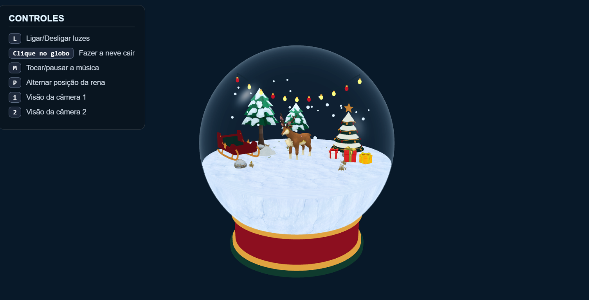
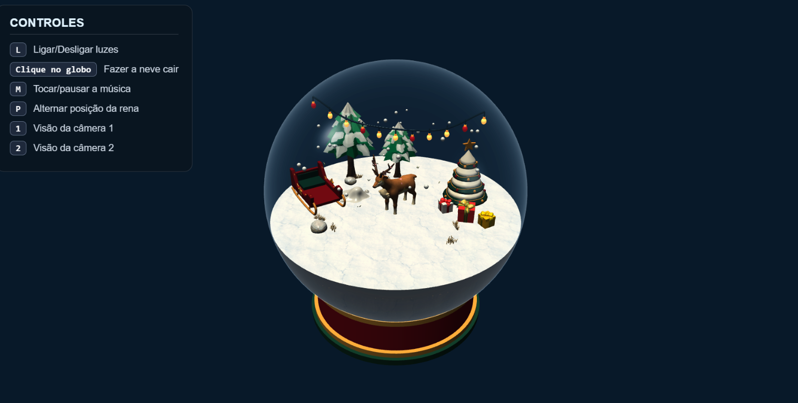

Globo de Neve Natalino 🎄❄️

(a) A Cena

A cena consiste em um diorama 3D de um globo de neve natalino. No interior da esfera de vidro transparente, encontra-se uma ambientação de inverno composta por itens natalinos. O diorama conta com um sistema de partículas simulando a neve em movimento de um globo após ser chacoalhado.

Para o mundo foram utilizados diversos elementos sob o chão com textura de neve. O hemisfério abaixo é representado pela base do globo de neve e utilizamos a árvore de natal como objeto hierárquico, representada pela árvore (estrutura fixa) e a estrela (parte giratória).

O personagem principal é uma rena que altera entre 3 orientações. 

A câmera é projetada conforme solicitado, assim como também a iluminação.

(b) Criadoras

Autoras: Caroline Leroy e Clara Barbi

(c) Media kit

(d) Opcionais

Lista de itens opcionais implementados no projeto:

- Modelos 3D de terceiros
- Variedade de objetos: Rena, grama, pedra, trenó, presentes, árvore de natal, árvores com neve, pisca-pisca suspensos, monte de neve (10 itens)
- Clique no globo de neve gera o efeito de partículas para simular flocos de neve 
- Música de fundo vinculada a tecla M
- Material transparente: esfera ao redor simulando vidro no globo
- Luz pontual no pisca-pisca suspenso 

(e) Créditos

Modelos 3D e Texturas: The Spriters Resource (Nintendo Switch)

Música de fundo natalina: Pixabay Audio

Biblioteca: TWGL.js